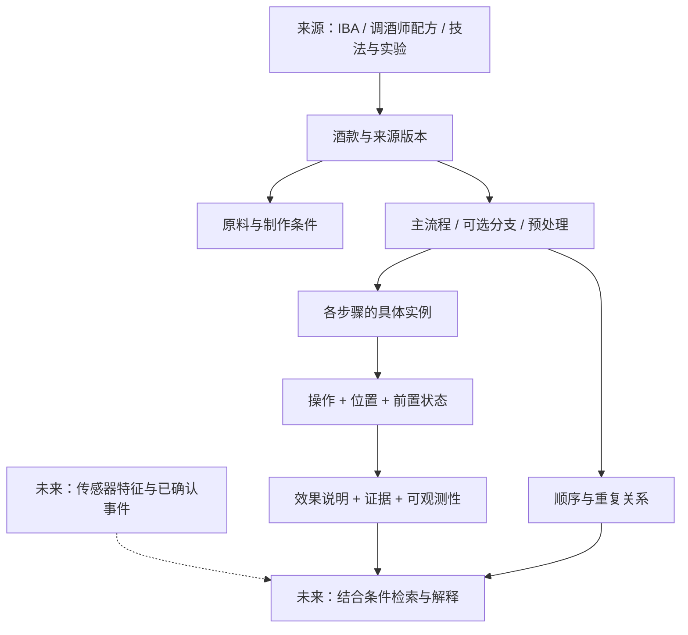

# 调酒操作知识库

版本：0.1.0｜采集与整理：2026-11-14｜定位：原理层的流程知识基础，供后续识别、复盘与前端说明共同使用。

**已经做成可查询的资料和代码。核心元件是「操作＋出现位置＋相关前置状态」，每款酒保存自己的有序路径。**

## 1. 这次实际收到了什么

| 内容 | 已完成范围 | 没有声称完成的部分 |
|---|---|---|
| IBA 官方配方 | 当日目录6页、102款，全部重新访问并核对原料、方法、装饰；102条主流程均已整理 | 不等于世界所有鸡尾酒 |
| 补充配方 | Death & Co公开配方13个、Difford版本1个、PDT调酒师署名配方1个 | 未遍历这些来源全部目录；未达到每款10—20份 |
| 方法与实验资料 | Arnold公开实验2篇、Difford技法3篇、Monin技法1篇 | 不是6篇同行评议论文，不应包装成论文共识 |
| 合并后的版本库 | 117个来源版本，115个不同酒名 | 同名不同做法没有取平均、没有强制合并 |
| 操作图谱 | 208个带上下文的元件、877条关系 | 不是208种基础动作，也不是877条已验证因果关系 |
| 可执行代码 | 构建、检索、读取配方、查询元件、比较已确认事件的顺序 | 不含自动动作识别、数值评分或完整原因诊断 |

来源链包括 [IBA目录](https://iba-world.com/cocktails/all-cocktails/)、[Death & Co公开配方](https://www.deathandcompanymarket.com/blogs/recipes)、[Difford的Whiskey Sour](https://www.diffordsguide.com/cocktails/recipe/2083/whiskey-sour-diffords-recipe)、[Don Lee/PDT署名配方](https://imbibemagazine.com/recipe/bentons-old-fashioned/)。技术资料链接和身份在 `补充来源.json` 中逐条记录。

IBA 抓取基础复用了项目已有文件，本轮核验无方法、原料、装饰内容变化；补充来源为本轮新增阅读整理。队友代码里的 `pc/reference/arnold_text_points.json` 明确引用了 Arnold 两篇原文，并注明工况不同、只能参考趋势；本库保留这一限制。Difford、Death & Co 与 PDT 渠道来自你本轮提供的搜集线索，再核验到具体页面。

**全量完成的是当日 IBA 目录。跨来源部分是第一批补充，不能叫“所有渠道、所有做法已经全收集”。**

## 2. 整个知识库的结构

```text
调酒知识库
├─ 来源库：谁说的、哪页、何时核验、是配方还是实验/经验
├─ 酒款版本库
│  ├─ 原料与用量（来源值，不是传感器值）
│  ├─ 主流程：每一步的操作、位置、条件、来源
│  ├─ 可选分支：蛋白、带冰出品、另一酒款变体等
│  └─ 原料预处理：例如糖浆制作、浸渍、脂洗
├─ 操作元件库
│  ├─ 操作 + 阶段 + 前置状态 + 所针对的原料/容器
│  ├─ 该位置的目的或效果，以及证据性质
│  └─ 现有硬件能否确认它真的发生
└─ 关系图
   ├─ 某步骤属于哪个元件
   ├─ 此版本中谁先、谁后
   ├─ 可选分支、预处理依赖、可重复循环
   └─ 同名酒款的不同来源版本
```

图谱不是一条强行套到所有酒上的总流程。它是**可重用元件＋不同酒款的路径＋局部顺序约束**。



## 3. 元件具体是什么样

以“加冰”为例，不能只有一个 `add_ice` 就结束：

| 元件 | 位置与前置状态 | 这个位置的作用 | 例子 |
|---|---|---|---|
| 溶糖后的加冰 | 糖先溶解，下一步摇和 | 使接下来的摇和进入带冰状态 | Daiquiri |
| 润杯后的加冰 | 苦艾酒已润出品杯，稍后会倒掉 | 为出品杯准备流程服务；不是摇和用冰 | Sazerac |
| swizzle 后补冰 | 液体已搅动，仍在出品杯 | 补足最后的出品冰 | Chartreuse Swizzle |
| 倒入出品杯后补冰 | 主体混合完成并转杯 | 改变出品阶段冰况 | Three Dots and a Dash |

这些位置来自对应 [IBA配方](https://iba-world.com/cocktails/all-cocktails/)；作用说明中涉及状态整理的部分标为“流程解释”，没有冒充测得的热量或风味变化。

每个元件在 JSON 中有以下字段：

```text
id                         稳定标识，供代码引用
├─ action                  基础动作，如 add_ice / shake / strain
├─ phase                   准备、主体、转杯、收尾、出品、原料预处理
├─ context                 冰况、容器、前一步、针对原料、已发生的动作等
├─ effects                 效果描述 / 证据类型 / 来源 / 定量结果（目前为空）
├─ observability           可识别候选，或当前不能可靠确认
└─ occurrences             哪个配方版本、第几步、来源哪个字段用了它
```

例如“带冰摇”和“带冰摇完、去冰之后再干摇”属于不同元件。只把两者都叫 shake 会丢失你最关心的顺序含义。

**阶段是大位置，前置状态才进一步限定含义。**“同在主体阶段”不代表两个动作可互换。

## 4. 已落入库中的典型路径

### 4.1 先溶糖，再加冰：Daiquiri

```text
原料入摇酒器 → 搅拌溶糖 → 加冰 → 带冰摇和 → 过滤出杯
                ↑          ↑
             准备动作      进入带冰处理阶段
```

这里“搅拌”发生在摇和前，承担溶糖任务，不能把它当成用户没有按要求摇酒。[来源](https://iba-world.com/iba-cocktail/daiquiri/)

### 4.2 同一个“摇”，前后作用不同：Ramos Fizz

```text
原料（预留苏打）+冰
        ↓
带冰摇2分钟 → 双滤去冰 → 液体倒回摇酒器
                                  ↓
                       无冰用力再摇1分钟
                                  ↓
                         过滤出杯 → 补苏打
```

上述时间是该页面明确写出的配方事实。页面历史故事中的“12分钟”没有混入执行步骤，更没有改成全酒款12—15秒。[来源](https://iba-world.com/iba-cocktail/ramos-fizz/)

### 4.3 “最后加入”不等于“最后一定搅拌”

```text
Tequila Sunrise：龙舌兰+橙汁+冰 → 加红石榴糖浆 → 不搅拌
French 75：主体摇和并过滤 → 加香槟 → 轻搅
Porn Star Martini：主体摇和并双滤 → 另附香槟小杯
```

三者分别是保留渐层、加气泡成分后轻搅、旁配饮品。不能抽象成一个“最后加酒”的通用元件。[Tequila Sunrise](https://iba-world.com/iba-cocktail/tequila-sunrise/)、[French 75](https://iba-world.com/iba-cocktail/french-75/)、[Porn Star Martini](https://iba-world.com/iba-cocktail/porn-star-martini/)

### 4.4 可重复的技法：冷饮拉倒

```text
有冰容器备料 → 滤器留冰 → 液体拉倒到另一容器 → 倒回有冰容器
                              ↑                    │
                              └──── 可重复 ────────┘
```

这里单独保留循环关系，未把某个作者的次数、稀释比例变成所有酒款的标准。它是扩展技法知识，尚不是现有杯体 IMU 的已验证训练项目。[来源](https://www.diffordsguide.com/g/1150/how-to-make-cocktails/how-to-throw-a-cocktail)

## 5. 同名酒款怎样处理不同做法

| 酒款 | 来源版本A | 来源版本B | 当前处理 |
|---|---|---|---|
| Whiskey Sour | IBA：带冰摇；使用蛋白时更有力 | Difford：带冰摇、滤冰、再干摇、精滤 | 两个独立版本，选择哪个版本才比较哪个流程 |
| Naked and Famous | IBA：摇和、过滤 | Death & Co：摇和、明确双滤 | 保留过滤细节差异，不宣布另一版本错误 |

不把配方差异平均成一条流程，不将出现次数最多的做法直接认证为“最好喝”。[IBA Whiskey Sour](https://iba-world.com/iba-cocktail/whiskey-sour/)、[Difford Whiskey Sour](https://www.diffordsguide.com/cocktails/recipe/2083/whiskey-sour-diffords-recipe)、[Death & Co Naked and Famous](https://www.deathandcompanymarket.com/blogs/recipes/naked-famous)

## 6. 如何接回三层产品结构

```text
① 准备层：选酒款版本、原料、冰、器具条件
       │  决定本次应该使用哪条知识路径/哪组实测参考
       ▼
② 原理层
   知识支路：路径 → 当前步骤 → 目的、前后约束、可能解释
   数据支路：T + IMU → T/f/A → 与实测参考比较 → 异常时段
       │               两条支路需要证据连接
       ▼
③ 原理到Web：把可确认的偏差翻译成说明
   → Web显示当前指导、最终结果与复盘
```

**这次完成的是②里的知识支路基础，以及①选择版本所需的配方数据。**

知识库没有生成 T/f/A 标准曲线，没有新增混合程度、稀释率或液体流速指标。温度15Hz、IMU100或200Hz、压力传感器不可用，仍按现有约束处理。

## 7. 什么可以反馈，什么目前不能

| 证据 | 当前可做 | 不能顺手推断 |
|---|---|---|
| 某来源明确规定步骤顺序 | 展示、查询该版本的顺序 | 用户必定执行或违反了它 |
| 用户或人工确认两个步骤实际发生且有先后 | 找出与所选来源路径的顺序差异 | 顺序差异必定导致多少分、多少口感损失 |
| 单独有温降曲线 | 给后续温度比较模块使用 | 唯一确定加冰时间、冰量、漏加原料 |
| 单独有杯体IMU | 给后续动作与f/A提取模块使用 | 液体混匀程度、静止杯中的搅拌情况 |
| 某步骤没被传感器识别 | 保持未知 | 直接宣布用户漏做 |

`查询.py` 的顺序比较只接受具体步骤实例；`inferred` 事件不会当成已确认事实。来源有未消解歧义时返回 `source_review_required`。它不输出分数，也不声称找到精确原因。

## 8. 已发现、已经明示的缺口

| 缺口 | 当前处理 | 后续应补什么 |
|---|---|---|
| 多来源深度不均 | 仅2个酒名已有第二来源版本；其余多数仍单来源 | 优先按技法缺口、来源冲突和准备训练的酒款补来源，之后扩展覆盖 |
| 书籍与视频未全读 | 不冒充收完《Liquid Intelligence》《Death & Co》《PDT》全文 | 合法可读版本、页码/视频时间戳及逐条来源 |
| 7个版本存在来源疑点或未说明处 | 保留原文与结构化疑点，暂停自动判断 | 核对原作者、另一明确来源或调酒师解释 |
| 可选分支尚非完整可执行子图 | 已建有条件分支节点，不自动追加到必做步骤 | 将分支展开成独立配方版本/明确子路径 |
| 装饰步骤粒度不一致 | 复杂杯口/挤皮操作已独立；普通装饰保留来源字段 | 按需补齐精细装饰动作，不用传感器强猜 |
| 跨来源原料身份尚未统一 | 已保留补充配方中的原料品牌/名称与用量 | 接入产品原料目录及规格；此时不做自动替换/酒精度推算 |
| 元件效果多为定性 | 区分配方指令、作者经验、公开实验与流程解释 | 效果方向和适用条件的专业复核；量化需单独实验 |
| 用户动作→事件尚未验证 | 当前只接已确认事件 | 定义可识别事件与识别置信度，无法观察的保留未知 |

具体疑点逐款在 `酒款覆盖.csv` 和 `知识库.json` 的 `open_issues` 中。不是所有未知都代表来源错误，例如 French 75 方法段没写冰况，只说明这个字段缺证据。

## 9. 关于你提供的五步方案

沿用：多来源收集、保留来源差异、检查异常、不随意丢弃分歧。

当前不执行：从文本时长推算终点温度/稀释率；把所有模糊时长补成12—15秒；用不同配方偏好的分散程度直接充当传感器评分容差。前两项已由“文本→知识库、实测→数值参考”替代。不同配方的分歧与同条件重复制作的测量波动不是一个统计总体。

`IQR / 1.35` 只是特定分布假设下的尺度估计，不能自动证明一个“允许误差阈值”。这次没有用它产生任何评分参数。

## 10. 文件与使用

先读本文件；想逐款检查，打开 `流程与元件索引.md`；筛选覆盖用 `酒款覆盖.csv`。

| 文件 | 用途 |
|---|---|
| `知识库.json` | 软件读取的完整图谱 |
| `IBA配方快照.json` | 102款原料、方法、装饰的已有采集快照 |
| `来源核验.json` | 本轮逐页核验结果 |
| `IBA步骤整理.json` | 102款主流程的中文语义整理，可修订后重建 |
| `补充来源.json` | 补充配方、技法、预处理和未完成渠道 |
| `采集.py` | 重访当前基线目录和配方；联网依赖 requests |
| `构建.py` | 校验来源与快照一致，生成图谱与覆盖表；纯Python标准库 |
| `查询.py` | 只读代码接口和命令行 |
| `test_知识库.py` | 关键流程、防误判及引用完整性测试 |

在这个文件夹里运行（读取和构建不需要联网）：

```bash
python3 构建.py
python3 查询.py search "Whiskey Sour"
python3 查询.py recipe iba-ramos-fizz
python3 查询.py component shake --ice absent
python3 查询.py coverage
python3 -m unittest discover -p 'test_*.py'
```

`recipe` 返回配方、原料、步骤、来源、分支与疑点；`component` 返回元件及其来源实例；`compare_observed_order(recipe_id, events)` 是供后续代码调用的顺序比对接口。事件需要 `step_id` 和 `evidence`，不得直接用原始IMU峰值冒充步骤ID。

采集脚本目前锁定本次IBA六页基线，用于复查而非长期全站增量爬虫。网站目录扩展、页面结构变化或字段变化后需要补采并复核，构建脚本不会替你自动改写已整理的知识。

**这版可以作为后续算法开发的知识底座，但“专业审核完成”“所有错误都能诊断”“每款10—20来源”三项都没有关闭。**

## 本轮接口补充（0.2.0）

每个配方已有内容版本哈希与 reference_binding。标准曲线独立保存、目前为空；新增标准曲线.py、标准曲线记录.json、网站图鉴接口.json。网站分工及契约见[网站接入说明](网站接入说明.md)。当前共23项测试通过；文件存储是单写入进程的本地接口，不是已上线的多用户服务。
